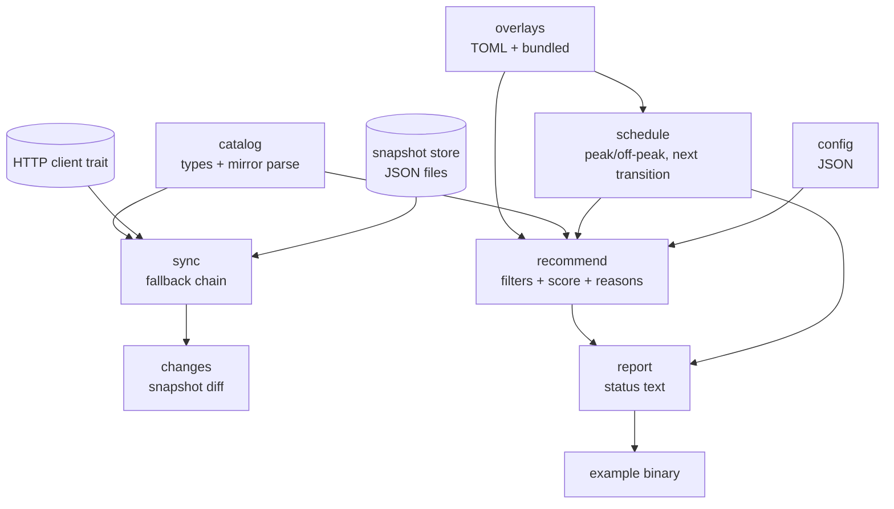

# Core v0.1 Design

**Spec**: `.specs/features/core-v01/spec.md`
**Status**: Draft

---

## Architecture Overview

One pure-Rust crate, `cost-guard-core`, organized by concern. External edges are two: the network (HTTP GET of the mirror) and the filesystem (config + snapshots). Everything else is deterministic in-memory logic. The future Tauri app (M2) depends on this crate, never the reverse; CI fails if the dependency graph gains Tauri or OS bindings.



### Approach exploration

1. **Single crate, module per concern** (chosen). ~3k LOC, one public surface, fast compile. Modules: `catalog`, `overlay`, `schedule`, `sync`, `recommend`, `config`, `report`. The only trait is `HttpClient`, because it is the only edge that needs test doubles.
2. **Multi-crate workspace** (`core-types`, `core-sync`, `core-recommend`). Clean isolation, but versioning and boilerplate for a small codebase; rejected.
3. **Full ports-and-adapters** (trait per edge, injected everything, filesystem behind traits). Maximum testability, but filesystem stubs add ceremony without a payoff: tests use `tempfile` directories instead. Rejected; kept the HTTP trait from it.

---

## Code Reuse Analysis

### Existing Components to Leverage

| Component | Location | How to Use |
| --------- | -------- | ---------- |
| None (greenfield codebase; only docs and specs exist) | `docs/`, `.specs/` | Design constraints only |

### Integration Points

| System | Integration Method |
| ------ | ------------------ |
| Catalog mirror `models.opencode.ai/api.json` | Anonymous GET with `If-None-Match`; schema parsed into catalog types; scope limited to provider `opencode-go` |
| Curated Overlays (`data/*.toml`) | Loaded from a caller-provided directory; bundled copies embedded with `include_str!` |
| Future Tauri app (M2) | Consumes the crate's public API; passes platform paths, runs `sync()` off the UI thread, renders `StatusReport` |

---

## Components

### `catalog`

- **Purpose**: Domain types plus parsing of the mirror payload into a Roster snapshot.
- **Location**: `crates/core/src/catalog/mod.rs`
- **Interfaces**:
  - `ModelEntry { id, provider_id, name, price: Price, cache_read, context, tool_call, attachment, reasoning, release_date }`
  - `CatalogSnapshot { schema, source, etag, fetched_at, models: Vec<ModelEntry> }`
  - `parse_mirror(json: &str) -> Result<MirrorParse, CatalogError>` where `MirrorParse { models: Vec<ModelEntry>, skipped: Vec<SkippedEntry> }`
- **Dependencies**: `serde`, `serde_json`
- **Reuses**: nothing (new)

### `overlay`

- **Purpose**: Load and validate curated TOML Overlays; expose typed accessors.
- **Location**: `crates/core/src/overlay/mod.rs`
- **Interfaces**:
  - `Overlays::bundled() -> Result<Overlays, OverlayError>` (embedded `include_str!`)
  - `Overlays::load_dir(dir: &Path) -> Result<(Overlays, Vec<Warning>), OverlayError>`
  - Typed structs: `WindowsOverlay`, `HolidaysOverlay`, `LimitsOverlay`, `CapabilitiesOverlay`
- **Metadata rule (DATA-01 as amended)**: each overlay file declares `source` and `last_verified`, inherited by every entry; entries may override with their own non-empty values.
- **Warnings**: unrated models (DATA-04), holiday coverage gaps (DATA-05).
- **Dependencies**: `toml`, `serde`
- **Reuses**: nothing (new)

### `schedule`

- **Purpose**: Pure pricing-window state machine.
- **Location**: `crates/core/src/schedule/mod.rs`
- **Interfaces**:
  - `state_at(now: DateTime<Utc>, overlays: &Overlays) -> WindowState`
  - `WindowState { peak: bool, next_transition: DateTime<Utc>, coverage_gap: Option<i32> }`
- **Rule**: peak iff `Mon–Fri` date (UTC), time in `[01:00,04:00)` or `[06:00,10:00)`, date not in the holiday calendar. Makeup weekends are naturally off-peak (weekend) and are asserted by test, not special-cased.
- **Dependencies**: `chrono`, `overlay`
- **Reuses**: nothing (new)

### `sync`

- **Purpose**: Fetch, validate, persist, fall back, and diff the Catalog.
- **Location**: `crates/core/src/sync/mod.rs`, `crates/core/src/sync/http.rs`
- **Interfaces**:
  - `trait HttpClient { fn get(&self, url: &str, etag: Option<&str>) -> Result<HttpResponse, HttpError>; }`
  - `HiResponse { status: u16, body: String, etag: Option<String> }` — note: struct name `HttpResponse`
  - `UreqClient::new(Duration::from_secs(10))`
  - `SyncEngine::new(client: &dyn HttpClient, store: SnapshotStore, bundled: CatalogSnapshot)`
  - `SyncEngine::sync() -> SyncOutcome { status: SyncStatus, warnings }`
  - `SyncStatus::{ Updated{source}, NotModified, Fallback{source, reason} }`, `ActiveSource::{Remote, LastValid, Bundled}`
- **Snapshot store**: `SnapshotStore::new(dir)`; files `catalog.current.json` and `catalog.previous.json`; atomic write via temp file + rename; a file that fails parse is treated as absent.
- **Change detection**: `detect_changes(previous, current) -> Vec<CatalogChange>` in `crates/core/src/sync/changes.rs`.
- **Dependencies**: `ureq`, `serde_json`, `catalog`, `tempfile` (dev)
- **Reuses**: `catalog::parse_mirror`

### `recommend`

- **Purpose**: Deterministic, explainable Recommendation per Task Profile.
- **Location**: `crates/core/src/recommend/mod.rs`, `crates/core/src/recommend/score.rs`
- **Interfaces**:
  - `Engine::recommend(profile: TaskProfile, window: &WindowState) -> Recommendation`
  - `Recommendation { pick: Option<Pick>, alternatives: Vec<Pick>, reasons: Vec<Reason>, no_candidate: Option<NoCandidate> }`
  - `Reason { code: ReasonCode, text: String }`
  - `ReasonCode::{OffPeakWindow, PeakWindow, StrongFit, CheapCost, CheapCache, AllowanceHeadroom, ContextFit, ToolsRequired, VisionRequired}` (closed set)
- **Scoring** (feature decision, documented for contributors):
  - `cost_index = 0.35 × effective_input + 0.65 × effective_output` per Mtok; `effective = off_peak × (peak ? multiplier : 1)`
  - `cost_score = min_cost_index / cost_index` over eligible candidates
  - `capability_score = profile override / 10`, else tier base (frontier 0.95, strong 0.80, standard 0.60, light 0.40)
  - `allowance_score = monthly_limit / max_limit`, neutral 0.5 when unlisted
  - `context_score = min(1, context / 200_000)`
  - `score = 0.55×capability + 0.30×cost + 0.10×allowance + 0.05×context`
  - Tie-break: lower `cost_index`, then stable by model id (REC-08)
- **Hard filters**: vision for Visual/UI; tools for Agentic/Tools/MCP; unrated models excluded; ignored models excluded.
- **Dependencies**: `catalog`, `overlay`, `config`
- **Reuses**: `schedule::WindowState`

### `config`

- **Purpose**: User config with defaults, validation and forward-compatible round-trip.
- **Location**: `crates/core/src/config/mod.rs`
- **Interfaces**:
  - `Config { autostart, notifications: { peak_enter, peak_exit }, default_profile, sync_interval_hours, ignored_models, extra: BTreeMap<String, Value> }`
  - `Config::load(dir) -> Result<Config, ConfigError>`, `Config::save(&self, dir)`, `Config::validate()`
  - `TaskProfile::{SimpleCoding, ComplexCoding, VisualUi, AgenticTools, LargeRefactor}` with `as_str`/`FromStr`
- **Dependencies**: `serde`, `serde_json`, `thiserror`
- **Reuses**: nothing (new)

### `report`

- **Purpose**: Render the demoable status report used by the example binary and, later, by M2's menu.
- **Location**: `crates/core/src/report/mod.rs`
- **Interfaces**:
  - `build_report(now: DateTime<Utc>, data_source: ActiveSource) -> Result<StatusReport, ReportError>`
  - `StatusReport { state, recommendations: Vec<(TaskProfile, Recommendation)>, source, warnings }` implementing `Display`
- **Dependencies**: all of the above
- **Reuses**: everything

### Example binary

- **Purpose**: Offline vertical slice printing state + 5 recommendations.
- **Location**: `crates/core/examples/status.rs`
- **Interface**: `cargo run -p cost-guard-core --example status`
- **Tests**: none (thin wrapper; `report` is unit-tested)

---

## Data Models

### Catalog snapshot JSON (`data/bundled/opencode-go.json`, `snapshot/catalog.current.json`)

```json
{
  "schema": 1,
  "source": "https://models.opencode.ai/api.json",
  "etag": "optional",
  "fetched_at": "2026-10-23T22:05:00Z",
  "models": [
    {
      "id": "deepseek-v4.1-flash",
      "provider_id": "opencode-go",
      "name": "DeepSeek V4.1 Flash",
      "price": { "input": 0.15, "output": 0.6 },
      "cache_read": 0.003,
      "context": 1048576,
      "tool_call": true,
      "attachment": true,
      "reasoning": true,
      "release_date": "2026-10-17"
    }
  ]
}
```

### Overlays (TOML, `data/`)

`pricing-windows.toml`:

```toml
schema = 1
source = "https://api-docs.deepseek.com/quick_start/pricing/"
last_verified = "2026-10-23"

[[provider]]
provider = "deepseek"
multiplier = 2.0
days = ["Mon", "Tue", "Wed", "Thu", "Fri"]
windows = [["01:00", "04:00"], ["06:00", "10:00"]]
```

`holidays-cn.toml`:

```toml
schema = 1
source = "https://www.gov.cn/ (official 2026 holiday notice)"
last_verified = "2026-10-23"

[[year]]
year = 2026
holidays = ["2026-01-01", "2026-02-17"]
makeup_weekends = ["2026-02-14"]
```

`limits.toml`:

```toml
schema = 1
source = "https://opencode.ai/v2/docs/console/go/"
last_verified = "2026-10-23"
plan = "opencode-go"

[[model]]
id = "deepseek-v4.1-flash"
monthly_usd = 80.0
```

`capabilities.toml`:

```toml
schema = 1
source = "https://models.dev + public model cards"
last_verified = "2026-10-23"

[[model]]
id = "deepseek-v4.1-flash"
tier = "frontier"
vision = true
tools = true
reasoning = true
context = 1048576
profiles = { simple = 6.0, complex = 9.0, visual = 7.0, agentic = 9.5, refactor = 8.5 }
notes = "cheap cache, strong agentic coding"
```

### Config JSON (`config.json`)

```json
{
  "autostart": false,
  "notifications": { "peakEnter": true, "peakExit": true },
  "defaultProfile": "simple-coding",
  "syncIntervalHours": 6,
  "ignoredModels": []
}
```

Unknown top-level keys are preserved on save via a flattened map.

---

## Error Handling Strategy

| Error Scenario | Handling | User Impact |
| -------------- | -------- | ----------- |
| Overlay file missing `source`/`last_verified` | Load fails naming the file/entry | App shows startup error instead of wrong data |
| Malformed window (end ≤ start, outside 00:00–24:00) | Load fails naming the entry | Same |
| Remote fetch failure (network/timeout/non-2xx) | Fallback: last valid → bundled; `Fallback` status names the active source | Stale but valid prices, visible source |
| Payload fails schema validation | Last valid snapshot untouched; fallback chain | No silent corruption |
| 304 with no valid snapshot | Treated as failure; fallback chain | No crash |
| Snapshot file truncated/partial | Treated as absent; fallback chain | No crash |
| Config invalid | Load error naming the field; file untouched | User fixes config |
| No candidate passes filters | `NoRecommendation` naming the failing filter | Menu shows why nothing fits |
| Missing holiday year | State computed without exclusions; coverage gap flagged | Visible warning; no silent wrong peak |

No panics on external data. Every public fallible function returns a typed error (`thiserror`).

---

## Risks & Concerns

| Concern | Location (file:line) | Impact | Mitigation |
| ------- | -------------------- | ------ | ---------- |
| Real-world seed data (CN 2026 holidays) must be verified during execution | `data/holidays-cn.toml` (new) | Wrong peak state on holiday dates | Task T6 requires official source URL recorded in `source`; schedule tests use synthetic calendars, not seed values |
| Capability seed ratings are subjective | `data/capabilities.toml` (new) | Recommendations skewed toward poorly-rated models | `notes` field documents rationale; author reviews before release; data is PR-editable |
| Overlay drift from upstream (peak 2×, limits) | `data/pricing-windows.toml`, `data/limits.toml` | Displayed price diverges from reality | `last_verified` + a review issue per upstream release; bundled snapshot refresh documented |
| Blocking HTTP (`ureq`) inside a future async Tauri app | `crates/core/src/sync/http.rs` | UI thread stalls if called naively | M2 runs `sync()` on a worker thread (`spawn_blocking`); documented in the public API docs |
| `include_str!` bundled paths couple crate to repo layout | `crates/core/src/overlay/mod.rs` | Build breaks if data moves | `CARGO_MANIFEST_DIR`-relative paths; layout asserted by CI build |
| No concurrency guards in `sync()` | `crates/core/src/sync/mod.rs` | Overlapping syncs could interleave writes | Single-flight is the caller's contract (M2 scheduler); documented; atomic writes keep files valid regardless |
| Tauri tray-title bug (tauri#12060) | n/a (M2) | Tray may vanish on title updates | Out of this feature; M2 spike first |

---

## Tech Decisions (only non-obvious ones)

| Decision | Choice | Rationale |
| -------- | ------ | --------- |
| Crate shape | Single crate `cost-guard-core`, module per concern | Small codebase; no cross-crate versioning overhead |
| HTTP | `ureq` + rustls behind `HttpClient` trait | Blocking is fine for a 6-hourly sync; hermetic tests via stubs |
| Time | `chrono` (UTC core, `Local` for display) | Ubiquitous API knowledge; UTC math avoids DST bugs |
| Errors | `thiserror` per module, no `anyhow` in core | Callers (M2) need typed variants |
| Pricing peak | Computed locally: off-peak × overlay multiplier | Upstream has no peak metadata (ADR-0002) |
| Cold-start catalog | Bundled JSON snapshot embedded with `include_str!` | Offline first run works; no network requirement |
| Snapshot names | Fixed `catalog.current.json` / `catalog.previous.json` | Exactly-two retention (ADR-0003); no pruning logic |
| Scoring weights | 0.55 capability / 0.30 cost / 0.10 allowance / 0.05 context | Quality-first for coding tasks; cost still decisive at peak |
| Test layout | Unit tests co-located; integration fixtures in `tests/` | Rust convention; acceptance matrix separate from unit tests |

> **Project-level decisions** were appended to `.specs/STATE.md` as AD-001..AD-005. The scoring weights and reason-code set are feature-local and stay in this table.
