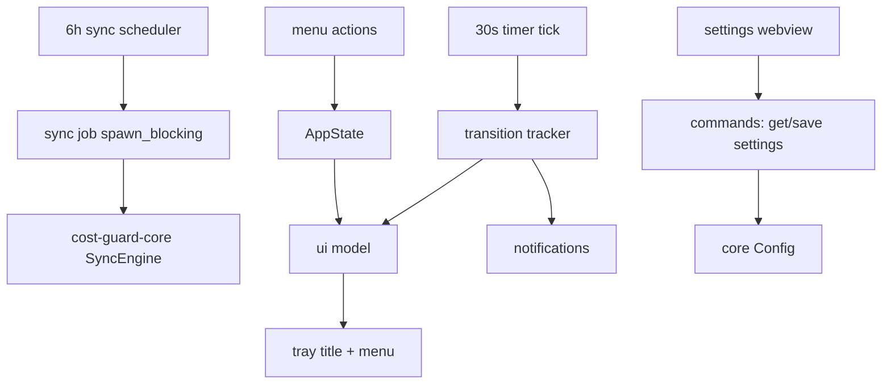

# M2 App Shell (macOS) Design

**Spec**: `.specs/features/m2-app-shell/spec.md`
**Status**: Draft

Facts verified on 2026-10-24 (macOS 26.6.2, Rust 1.97.1): Tauri 2.12.5 / tauri-build 2.7.4 / tauri-cli 2.12.4 / plugins 2.7.0; tray title runtime updates work (4 runs, 8 updates, tray never vanished); tauri#12060 open upstream but not reproducible here.

---

## Architecture Overview

A Tauri 2 app in `crates/app` (workspace member, `tauri.conf.json` at the crate root, static `ui/` frontend) with a thin webview used only for settings. All business logic stays in `cost-guard-core`; the app adds platform wiring, a pure "UI model" layer, and background timers.



**State ownership:** one `Mutex<AppState>` in Tauri managed state: `Config`, `Overlays`, current snapshot, `ActiveSource`, `last_sync_at`, badge flag, `TaskProfile`, `TransitionTracker`.

**Threading:** sync runs on a worker (`tauri::async_runtime::spawn_blocking`) guarded by a single-flight `AtomicBool`; tray/menu setters dispatch to the main thread internally (verified); menu/tray objects are updated only on state change.

### Approach exploration

1. **Thin app + pure UI-model modules** (chosen): strings, transition detection and scheduler decisions are pure functions with unit tests; Tauri glue stays thin and is verified by build + manual smoke.
2. **Logic inside Tauri callbacks**: fast to write, untestable; rejected.
3. **Headless daemon + separate UI process**: overkill; rejected.

---

## Components

### `crates/app` scaffold

- **Purpose**: Tauri app crate (package `cost-guard-app`), build script, config, icon, Info.plist, capabilities, static `ui/`.
- **Verified layout**:

```
crates/app/
├── Cargo.toml
├── build.rs                  # tauri_build::build()
├── tauri.conf.json           # app.windows: [], withGlobalTauri, frontendDist: "ui", bundle app
├── Info.plist                # LSUIElement = true
├── capabilities/default.json # core:default, notification:default, autostart:default (window: settings)
├── icons/icon.png            # required by codegen (placeholder for now)
├── ui/index.html             # settings page (+ settings.js)
└── src/main.rs
```

- **Commands** (verified): `cd crates/app && cargo tauri dev`; `cargo run -p cost-guard-app` (embedded assets, no dev server); `cargo tauri build --bundles app` → `target/release/bundle/macos/Cost Guard.app`.
- **tauri-cli is not installed on this machine**; install 2.12.4 prebuilt into `~/.cargo/bin` (documented in CONTRIBUTING).

### `app_state.rs`

- **Purpose**: Load config/overlays/snapshots and expose mutations to timers, menu and settings.
- **Location**: `crates/app/src/app_state.rs`
- **Interfaces**:
  - `AppState::load(data_dir: PathBuf) -> Result<AppState, AppError>`
  - `refresh_snapshot(&mut self) -> ActiveSource`
  - `apply_sync_outcome(&mut self, outcome: &SyncOutcome) -> bool` (returns `badge_changed`)
  - `set_profile`, `save_settings`, `acknowledge_changes`
- **Reuses**: `cost_guard_core::{config, overlay, sync, catalog, recommend}`.

### `ui_model.rs` (pure, unit-tested)

- **Purpose**: Exact strings for tray and menu; no Tauri types.
- **Location**: `crates/app/src/ui_model.rs`
- **Interfaces**:
  - `tray_title(peak: bool, badge: bool) -> String` → `🟢 off`, `🔴 2×`, suffix ` ⚠`
  - `state_label(peak: bool) -> &'static str` → full `🟢 DS off` / `🔴 DS 2×` for the menu header
  - `price_lines(model, state, multiplier)`; `next_transition_line(utc, local)`
  - `recommendation_lines(&Recommendation)`; `source_line(ActiveSource, last_sync)`
- **Tests**: exact strings for peak/off-peak, badge, peak-aware prices, no-candidate reason, fallback source.

### `events.rs` (pure, unit-tested)

- **Purpose**: Peak transition detection + notification dedupe.
- **Location**: `crates/app/src/events.rs`
- **Interfaces**: `TransitionTracker::observe(peak: bool, notifications: &Notifications) -> Option<Transition>`
- **Tests**: off→peak once; repeated ticks silent; peak→off once; disabled toggles suppress.

### `sync_job.rs`

- **Purpose**: Core sync off the UI thread, single-flight.
- **Location**: `crates/app/src/sync_job.rs`
- **Interfaces**: `spawn_sync(app: AppHandle)`; guard `AtomicBool`; `SnapshotStore` from the app data dir; `UreqClient` with 10 s timeout; emits completion back to the main thread.
- **Tests**: `should_sync(now, last_sync, interval)` and badge transition via `app_state` unit tests.

### `timer.rs`

- **Purpose**: 30 s state tick and interval sync scheduling.
- **Location**: `crates/app/src/timer.rs`
- **Behavior**: `tokio::time::interval` with `MissedTickBehavior::Skip`; first tick used for initial title; sync trigger on interval elapse; no title write when state/badge unchanged (tauri#12060 hygiene: update only on transitions, stable-width text, never toggle title off).

### `menu.rs` + `tray.rs`

- **Purpose**: Native tray and menu; rebuilt only on state change.
- **Location**: `crates/app/src/menu.rs`, `crates/app/src/tray.rs`
- **Behavior**: items: state header, next transition (local + UTC), price block, profile check items, recommendation + reason lines, alternatives submenu, source/last-sync line, Acknowledge changes (visible only when badge set), Sync Catalog (disabled while syncing), Settings, Quit.
- **Tray**: `TrayIconBuilder::with_id("main")` + template icon + `title(...)`, `show_menu_on_left_click(true)` (left click opens the menu, the macOS norm); dynamic `set_title(Some(..))`, `set_menu(Some(menu.clone()))`.
- **Spike-informed rules**: no title write inside `setup()`; coalesce updates; keep width stable; fallback to icon color + tooltip behind `tray_title_ok` flag with a one-time log if `set_title` errors.

### `settings.rs` + `ui/`

- **Purpose**: Settings window (static HTML/JS) and commands.
- **Location**: `crates/app/src/settings.rs`, `crates/app/ui/index.html`, `crates/app/ui/settings.js`
- **Interfaces**:
  - `settings_get() -> SettingsDto`
  - `settings_set(dto) -> Result<(), FieldError>` (maps core `ConfigError` to `{ field, message }`)
  - window `settings`: 520×420, non-resizable, close→hide, label matches capability.
- **Autostart**: plugin `Builder::new().app_name("dev.ivanseibel.costguard").macos_launcher(MacosLauncher::LaunchAgent)`; never enable when `tauri::is_dev()`.
- **Reuses**: `Config::load/save/validate`.

### `capabilities/default.json`

- **Content**: starts with `core:default`; `notification:default` is added when the notification plugin lands (T7) and `autostart:default` when autostart lands (T9). `windows: ["settings"]`. Custom commands need no ACL entry (verified).

---

## Data Flow

1. **Startup**: resolve app data dir (`dev.ivanseibel.costguard`) → `Config::load` (defaults when missing) → `Overlays::bundled()` → `SnapshotStore` current or bundled → build tray + menu → start timers → spawn first sync.
2. **Tick**: `state_for("deepseek")` → tracker → on transition: title/menu update + notification (if enabled); sync when due.
3. **Sync finished**: persist outcome, active source, `last_sync_at`; `detect_changes` non-empty → badge on; rebuild menu/title.
4. **Menu action**: profile → persist; acknowledge → badge off; sync → spawn; settings → show; quit → `app.exit(0)`.
5. **Settings save**: validate → persist → apply autostart → update memory → rebuild menu.

---

## Error Handling Strategy

| Error Scenario | Handling | User Impact |
| -------------- | -------- | ----------- |
| Overlays fail at startup | Keep app alive; error item in menu; tray shows fallback state | Visible error, no crash |
| Config invalid | In-memory defaults; error item; file untouched | User fixes settings |
| Sync failure | Keep last valid state; source line shows fallback | Stale but valid |
| Settings invalid | Field-level error in window; nothing persisted | Inline feedback |
| Tray title call fails | Switch to icon+tooltip fallback once; log | Still usable |

No panics on external data; core `thiserror` variants map to user strings in `ui_model`.

---

## Risks & Concerns

| Concern | Location | Impact | Mitigation |
| ------- | -------- | ------ | ---------- |
| tauri#12060 (tray vanishes on title update) | `crates/app/src/tray.rs` | Tray disappears | Spike: not reproducible (4 runs/8 updates). Keep transition-only updates, stable width, no title write in setup; icon fallback behind a flag |
| Notification backend is legacy `NSUserNotificationCenter` | plugin | Silent notifications on future macOS | Verify on this macOS in smoke; document; UNUserNotificationCenter fallback postponed |
| `cargo-tauri` absent locally | toolchain | `tauri build` fails | Install prebuilt 2.12.4 into `~/.cargo/bin`; `cargo run -p cost-guard-app` works without CLI |
| Ubuntu CI cannot build the Tauri crate | CI | Ubuntu job fails on GTK deps | Ubuntu job runs core only; macOS job checks/builds the app |
| Menu mutation while open | `crates/app/src/menu.rs` | Undefined UI behavior | Rebuild only on state change; transitions are rare |
| Settings window blocks quit | `crates/app/src/settings.rs` | App never exits | Close→hide; Quit calls `exit(0)`; `RunEvent::ExitRequested` prevented only for hidden windows |
| Icon requirement in codegen | `crates/app/icons/icon.png` | Build fails | Ship placeholder icon now; real icon is v0.2 |
| No `macos-27` CI runner | CI | Future drift | Build on `macos-26` (current runner); verify locally on 26.6.2 |

---

## Tech Decisions (feature-local)

| Decision | Choice | Rationale |
| -------- | ------ | --------- |
| Layout | `crates/app` with `tauri.conf.json` at crate root; `frontendDist: "ui"` | Verified CLI discovery at depth ≤3; no Node |
| Commands | `cd crates/app && cargo tauri dev`; `cargo run -p cost-guard-app`; `cargo tauri build --bundles app` | All verified |
| Menu refresh | Rebuild only on state change | Avoids open-menu mutation; transitions are rare |
| Sync | Blocking core client on `spawn_blocking`, single-flight | Core API is blocking; no async deps in core |
| Settings transport | `withGlobalTauri` + `invoke` from plain JS | No bundler |
| Autostart | LaunchAgent via plugin 2.7, stable app_name, dev-gated | Verified behavior |
| Tray title | Template icon + title; update only on transitions | Spike-validated; #12060 hygiene |
| Tests | Pure modules unit-tested; GUI behaviors via build + smoke checklist | Deterministic CI |
